PressDesk

PressDesk is a web app for editors at small independent presses who receive manuscripts from writers. Instead of keeping submissions scattered across email attachments, editors upload each manuscript as a Word, PDF, or text file, and PressDesk automatically splits it into chapters. They can then read it chapter by chapter, track which chapters they’ve read, add notes as they go, and move the manuscript through the decision stages: received, reading, shortlisted, accepted, or declined. Each press’s manuscripts are private to its own account.

Live site: https://pressdesk-23c91ab98baa.herokuapp.com/


## Contents

- [Rationale](#rationale)
- [User stories](#user-stories)
- [UX design](#ux-design)
- [Features](#features)
- [Data schema](#data-schema)
- [Security](#security)
- [Technologies](#technologies)
- [Testing](#testing)
- [Bugs](#bugs)
- [Deployment](#deployment)
- [Running locally](#running-locally)
- [Development notes](#development-notes)
- [Credits](#credits)

## Rationale
PressDesk is a reading desk for small independent presses. It gives an editor one private place to upload manuscripts, read them chapter by chapter, take notes as they go, and track each submission from arrival to final decision.


### Target audience
- Editors and publishers at small independent presses, often a team of one to
  five people, who read unsolicited and agented submissions themselves.
- Readers and assistant editors who share the first read of the submissions
  pile.

These users are not developers. They need a tool that works straight away, with no setup, training or technical knowledge.

### The problem
Small presses usually receive manuscripts as email attachments: Word documents, PDFs and plain text files, each formatted differently. An editor ends up with:

- manuscripts scattered across an inbox, downloads folder and desktop;
- whole novels opened as one long document, with no easy way to read a chapter at a time or see how far they have got;
- reading notes kept separately in notebooks, spreadsheets or the margins of a file, cut off from the text they refer to;
- no clear overview of which submissions are new, being read, shortlisted, accepted or declined.

Larger submission platforms exist, but they focus on collecting submissions and are built for bigger organisations. PressDesk focuses on the part that takes a small press the most time: reading and deciding.

### Why a web app

- **Available anywhere.** An editor can read on a laptop at the office and pick up the same chapter on a phone or tablet later, with nothing to install.
- **Works with the files presses already receive.** Uploading a .docx, .pdf or .txt file is all it takes; PressDesk splits it into chapters automatically.
- **Keeps everything together.** Manuscripts, chapters, notes and statuses are stored in one database, so nothing is lost between files and folders.
- **Private by account.** Each press logs in to see only its own manuscripts, which matters when handling unpublished work.

### Value to the user

PressDesk turns a clutered inbox into a clear reading list. Editors can see at a glance how many manuscripts are waiting at each stage, read submissions in manageable chapters rather than one long scroll, and keep their notes next to the text, ready to refer back to when making a decision or writing to the author.

## User stories
## User stories

### New visitor

| As a… | I want to… | So that… |
|---|---|---|
| new visitor | understand what PressDesk does from the home page | I can decide whether it is useful for my press |
| new visitor | create an account with my name, email and press name | I can start using PressDesk |
| new visitor | see clear messages if I make a mistake when registering | I know what to correct |

### Returning publisher

| As a… | I want to… | So that… |
|---|---|---|
| publisher | log in and out securely | my press's manuscripts stay private |
| publisher | know that other presses cannot see my manuscripts | unpublished work is kept confidential |

### Uploading manuscripts

| As a… | I want to… | So that… |
|---|---|---|
| publisher | upload a manuscript as a .docx, .pdf or .txt file | I can work with the files authors actually send |
| publisher | drag a file onto the page or choose it with a button | uploading is quick and easy |
| publisher | see a progress bar while a file uploads | I know the upload is working |
| publisher | have the manuscript split into chapters automatically | I don't have to divide it up myself |
| publisher | have long manuscripts with no chapter headings split into parts | I'm not faced with one very long page |
| publisher | get a clear error if a file is empty, too large or the wrong type | I understand what went wrong and can try again |

### Reading and notes

| As a… | I want to… | So that… |
|---|---|---|
| publisher | read a manuscript one chapter at a time | long submissions are easier to read |
| publisher | move between chapters with a chapter list and Previous / Next buttons | I can find my place quickly |
| publisher | mark chapters as read | I can see how far I've got |
| publisher | add notes to a chapter | my thoughts stay next to the text they're about |
| publisher | edit and delete my notes | I can update my thinking as I read on |

### Managing submissions

| As a… | I want to… | So that… |
|---|---|---|
| publisher | set each manuscript's status (received, reading, shortlisted, accepted, declined) | I can track where every submission stands |
| publisher | have a manuscript move to "reading" when I first open it | its status stays accurate without extra clicks |
| publisher | see how many manuscripts are at each status on my dashboard | I get an overview of my submissions at a glance |
| publisher | filter by status and search by title or author | I can find a manuscript quickly |
| publisher | edit a manuscript's title, author and genre | I can correct details entered at upload |
| publisher | delete a manuscript, with a confirmation step first | I can clear out old submissions without deleting one by mistake |

### Using the site

| As a… | I want to… | So that… |
|---|---|---|
| publisher | use PressDesk on my phone or tablet | I can read submissions away from my desk |
| publisher | use the site with a keyboard or screen reader | PressDesk is accessible to me |
| publisher | see a helpful page if a link is broken or something goes wrong | I'm never left stuck |

## UX design

### Wireframes

Desktop Wireframes:

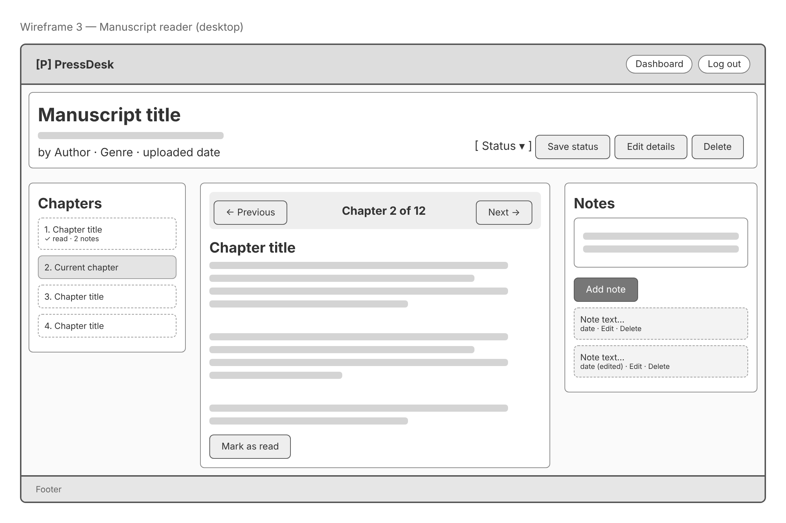


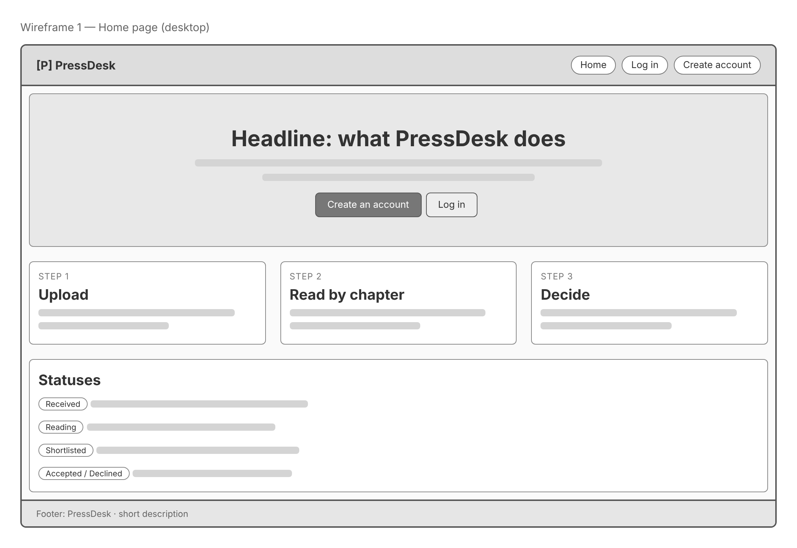

Mobile Wireframes:

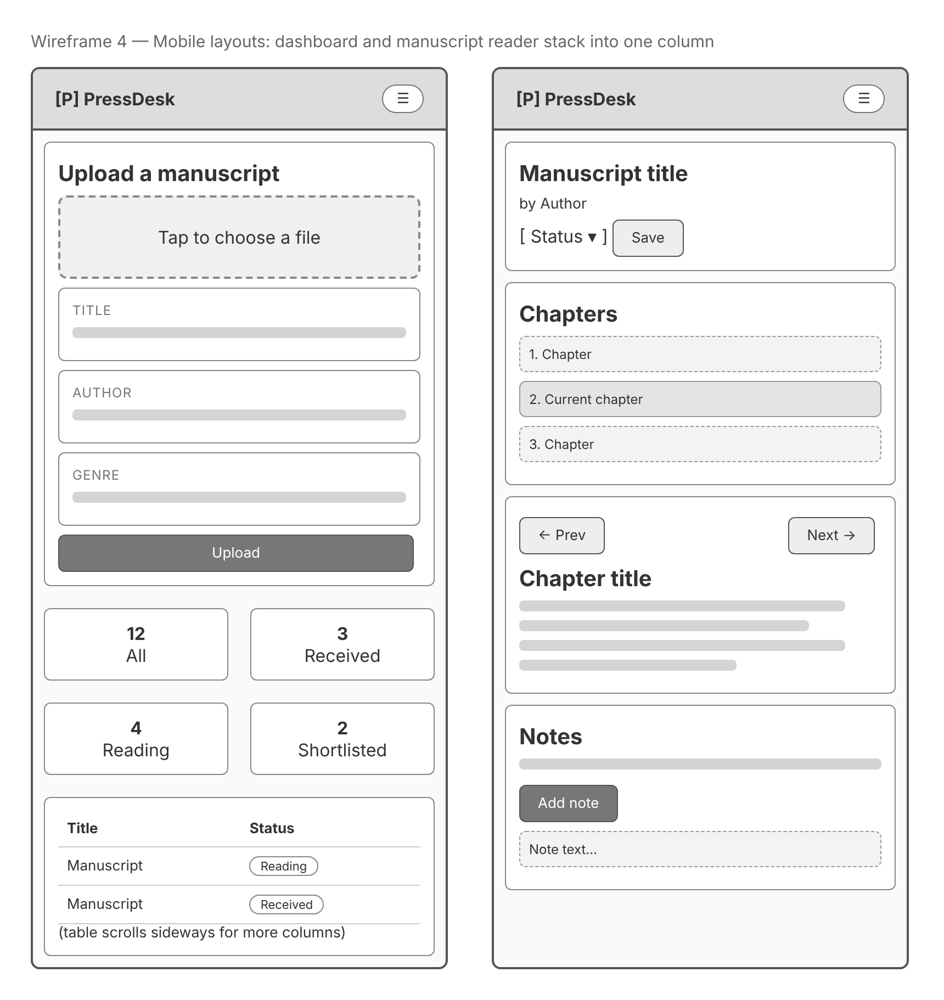


### Colour scheme
### Colour scheme

PressDesk uses a deep teal as its main colour, with yellow as a highlight, like
a highlighter pen on a manuscript. The palette is calm so the text being read
always comes first. All colours are stored as CSS variables at the top of
`style.css`, so the whole scheme can be changed in one place.

**Brand colours**

| Colour | Hex | Used for |
|---|---|---|
| Teal | `#0d6b5a` | Header, main buttons, links |
| Dark teal | `#0a4f43` | Hover states for buttons and links |
| Teal tint | `#e2f2ed` | Secondary buttons, upload area background |
| Yellow | `#ffd84d` | Logo mark, focus outlines, the main button on the home page |
| Yellow tint | `#fff6cc` | Notes (like sticky notes), the current chapter, hovered table rows |

**Neutrals**

| Colour | Hex | Used for |
|---|---|---|
| Text | `#1c2624` | Main text (a very dark green-grey, softer than pure black) |
| Soft text | `#586662` | Secondary text such as dates and descriptions |
| Page | `#eef2f1` | Page background |
| Card | `#ffffff` | Panels and cards |
| Field | `#f5f8f7` | Form fields, alternate table rows |
| Line | `#d6dedb` | Borders |

**Messages**

| Colour | Hex | Used for |
|---|---|---|
| Success text / background | `#1a6136` / `#def3e6` | Green confirmation messages |
| Error text / background | `#b42318` / `#fde4e1` | Red error messages |

**Status tags**

Each status has its own colour so manuscripts can be told apart at a glance.
The status name is always written in the tag too, so meaning never depends on
colour alone.

| Status | Text | Background |
|---|---|---|
| Received | `#4c5754` | `#e6ebea` |
| Reading | `#1d4fb8` | `#e1eafc` |
| Shortlisted | `#8a5600` | `#fdefc8` |
| Accepted | `#1a6136` | `#d9f1e2` |
| Declined | `#b42318` | `#fde4e1` |

Text and background pairs were chosen for strong contrast, and Lighthouse
reported no contrast problems.

### Typography

Both fonts are loaded from [Google Fonts](https://fonts.google.com/), with
system fonts as fallbacks if they fail to load.

- **[Bricolage Grotesque](https://fonts.google.com/specimen/Bricolage+Grotesque)**
  for headings and the PressDesk logo. It has a slightly hand-made, editorial
  character that suits a tool for publishers, while staying clean and modern.
  Headings are bold (700–800) with tight letter spacing.
  *Fallbacks: Avenir Next, Arial, sans-serif.*
- **[Atkinson Hyperlegible](https://fonts.google.com/specimen/Atkinson+Hyperlegible)**
  for all body text. It was designed by the Braille Institute to be easy to
  read for people with low vision, with letters that are hard to confuse
  (such as I, l and 1). Since PressDesk is a tool for reading long manuscripts,
  readability was the main priority.
  *Fallbacks: Helvetica Neue, Arial, sans-serif.*

**Sizes and spacing**

- Body text is 17px (`1.0625rem`) with a line height of 1.6.
- Chapter text is slightly larger, at 18px (`1.125rem`), with a line height of
  1.85 and a maximum width of about 68 characters per line, a comfortable
  length for long reading.
- The main page heading scales with the screen size (`clamp()`), so it fits
  phones without being too small on desktops.
  
### Accessibility

PressDesk is a reading tool, so it was designed to be comfortable and usable
for as many people as possible, including keyboard and screen reader users.

- **Readable font:** body text uses Atkinson Hyperlegible, designed by the Braille Institute for readers with low vision. Chapter text is set larger, with generous line spacing and a limited line length for long reading.
- **Colour contrast:** text and background colours were chosen for strong contrast, and checked with Lighthouse.
- **Never colour alone:** every status tag shows its name as text as well as its colour, so it can be understood by people who can't tell the colours apart.
- **Visible focus:** links, buttons and the upload area show a clear outline when reached with the keyboard (`:focus-visible`), so keyboard users can always see where they are.
- **Labelled forms:** every form field has a visible `<label>`, so screen readers announce what each field is for and clicking the label selects the field.
- **Keyboard-friendly upload:** the drag-and-drop area is a label for a normal file input, so it can be reached with Tab and opened with Enter, and it still works if JavaScript is turned off.

## Features

### Register and log in

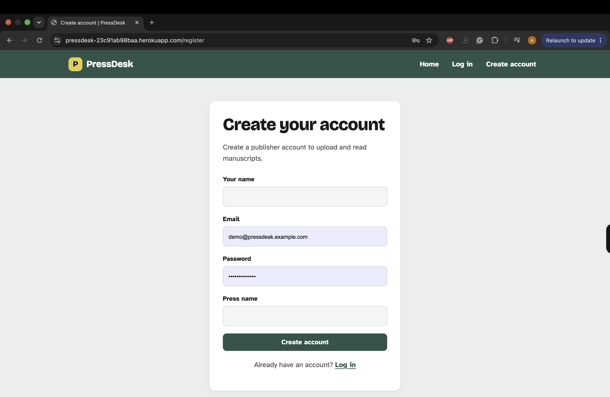

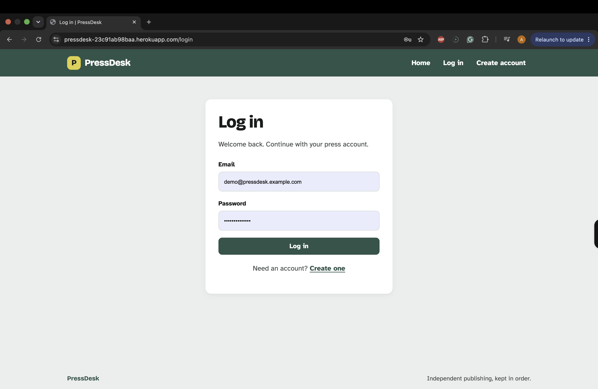

### Dashboard

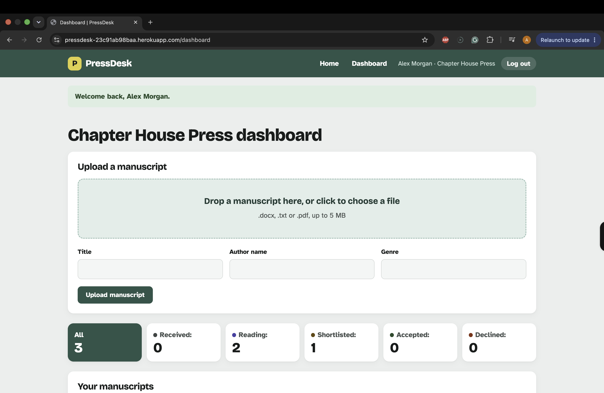

### Status

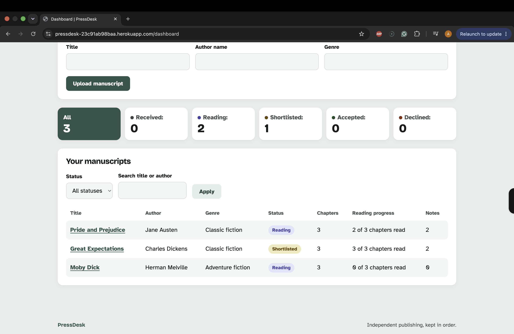


## Data schema

PressDesk uses a relational database: SQLite while developing locally and PostgreSQL on Heroku. The models are defined in `app/models.py` with Flask-SQLAlchemy, and changes to the database are managed with Flask-Migrate.

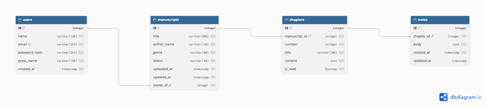

*ERD made with [dbdiagram.io](https://dbdiagram.io). 

User: a publisher account

Field	Type	Notes
id	Integer	Primary key
name	String	
email	String	Unique, stored in lower case
press_name	String	
password_hash	String	Never stores the plain password

Manuscript: one submission, owned by one user

Field	Type	Notes
id	Integer	Primary key
title	String	
author_name	String	
genre	String	
status	String	received / reading / shortlisted / accepted / declined
uploaded_at	DateTime	
owner_id	Integer	Foreign key → User

Chapter: one chapter of a manuscript

Field	Type	Notes
id	Integer	Primary key
number	Integer	Order in the manuscript
title	String	
content	Text	
is_read	Boolean	
manuscript_id	Integer	Foreign key → Manuscript

Note: a note on one chapter

Field	Type	Notes
id	Integer	Primary key
body	Text	
created_at	DateTime	
updated_at	DateTime	Empty until edited
chapter_id	Integer	Foreign key → Chapter

Relationships: one user has many manuscripts; one manuscript has many chapters; one chapter has many notes. Deleting a manuscript deletes its chapters and notes.

## Security
- Secret keys and the database URL are kept in environment variables (env.py locally, which is in .gitignore; Config Vars on Heroku). They are never committed.
- DEBUG is off unless explicitly set to "True", and is off on the live site.
- Passwords are hashed, never stored as plain text.
- All manuscript, chapter and note pages require login.
- Every item is checked against the logged-in publisher, and other publishers' items return a 404.
- All forms are protected against CSRF.
- Redirects after login only go to pages on this site.
- Uploads are limited to 5 MB and to .docx, .txt and .pdf files.

## Technologies
Languages: Python, HTML, CSS, JavaScript
Framework and libraries: Flask, Flask-SQLAlchemy, Flask-Migrate, Flask-Login, Flask-WTF, python-docx, pypdf, Gunicorn
Database: SQLite locally, PostgreSQL on Heroku
Tools: Git, GitHub, VS Code, Heroku, pytest, dbdiagram.

## Testing

### Automated tests

Run with:

bash
python -m pytest

The automated tests in `tests/test_chapters.py` cover the part of PressDesk with the most logic: working out where chapters start and splitting text into readable sections. These functions in `app/chapters.py` take text in and give results out without needing the database or a browser, so they can be tested quickly and reliably.

### Manual testing

All tests were carried out on the deployed site in a private browser window.

| Test | Steps | Expected | Result |
|---|---|---|---|
| Register | Click "Create account", fill in name, email, press name and password, submit | Account created; redirected to log in with "Your account has been created. Please log in." | Pass |
| Duplicate email | Register again with an email that already has an account | Error: "An account with that email already exists." | Pass |
| Invalid login | Log in with a wrong password | Error: "Invalid email or password." | Pass |
| Log in | Log in with correct details | Dashboard opens with "Welcome back, [name]." | Pass |
| Log out | Click "Log out" in the header | Returned to the home page with "You have been logged out." | Pass |
| Upload .pdf | Upload `samples/frankenstein.pdf` | "Uploaded 'Frankenstein' — [n] chapters found." Opening letters kept as "Opening pages", then Chapters 1–24 | Pass |
| Upload .docx | Upload `samples/alice-in-wonderland.docx` | "[n] chapters found." Chapters named from the Heading 1 styles, e.g. "Down the Rabbit-Hole" | Pass |
| No headings | Upload `samples/im-bernsteinwald.txt` | Split into [n] parts of about 3,000 words ("Part 1", "Part 2"…); German characters (ä, ö, ü) display correctly | Pass |
| Empty file | Upload `samples/empty.txt` | Error: "The file you chose is empty." Nothing uploaded | Pass |
| Wrong file type | Upload a .png or .jpg | Error: "Only .docx, .txt and .pdf files can be uploaded." Nothing uploaded | Pass |
| File too large | Upload a file over 5 MB | Error: "The file is too large. The maximum size is 5 MB." | Pass |
| Drag and drop | Drag a sample file onto the upload area | Upload area highlights; file name shown under it | Pass |
| Upload progress | Upload a sample file | Progress bar shows, then "Splitting into chapters…" | Pass |
| Open manuscript | Open a manuscript with status "Received" | First chapter shown; status changes to "Reading" with a message | Pass |
| Chapter navigation | Use the chapter list and Previous / Next buttons | Correct chapter opens; Previous hidden on the first chapter, Next on the last | Pass |
| Mark chapter read | Mark a chapter as read, then unread | "'[chapter]' marked as read." / "…marked as unread." | Pass |
| Add note | Type a note on a chapter and save | "Note added to '[chapter]'." Note appears in the list | Pass |
| Empty note | Save a note with nothing in it | Error message; Please fill in this field | Pass |
| Edit note | Click "Edit" on a note, change it, save | "Your note was updated." Note shows as edited | Pass |
| Delete note | Click "Delete" on a note, then confirm | Confirmation page first, then "Your note was deleted." | Pass |
| Change status | Choose a new status and save | "'[title]' is now marked as [status]." Dashboard count updates | Pass |
| Edit manuscript details | Change title, author or genre and save | "'[title]' was updated." New details shown | Pass |
| Delete manuscript | Click "Delete", then confirm | Confirmation page showing chapter and note counts, then "'[title]' and all its chapters and notes were deleted." | Pass |
| Cancel delete | Click "Delete", then "Cancel" | Returned to the manuscript; nothing deleted | Pass |
| Filter by status | Click a status count on the dashboard | Only manuscripts with that status shown | Pass |
| Search | Search for a title or author name | Only matching manuscripts shown | Pass |
| Page that doesn't exist | Visit `/manuscripts/9999` | Custom 404 page | Pass |
| Back button | Delete a manuscript, then press the browser's back button | No crash; the deleted manuscript can't be opened | Pass |
| Demo account | Log in with the demo details from the README | Dashboard shows three demo manuscripts | Pass |
| Keyboard only | Use Tab and Enter to log in and open a manuscript | Focus outline always visible; everything reachable | pass |
| Mobile layout | Open the site on a phone | Layout fits the screen with no sideways scrolling | Pass|

### Automated tests

`tests/test_chapters.py` contains 5 pytest tests for chapter detection and
splitting, run with `python -m pytest`.

| Test | Checks | Result |
|---|---|---|
| `test_numbered_heading` | "Chapter 1" is a heading | Pass |
| `test_roman_numeral_heading` | "CHAPTER XII" is a heading | Pass |
| `test_sentence_is_not_heading` | "Chapter and verse, she said" is not a heading | Pass |
| `test_short_text_stays_whole` | A short text with no headings stays as "Full manuscript" | Pass |
| `test_long_text_is_split_into_parts` | A 10,000-word text with no headings is split into parts | Pass |

Together these check both sides of heading detection (real headings are found, and ordinary sentences are left alone) and both outcomes when there are no headings (short texts stay whole, long texts are split into parts).

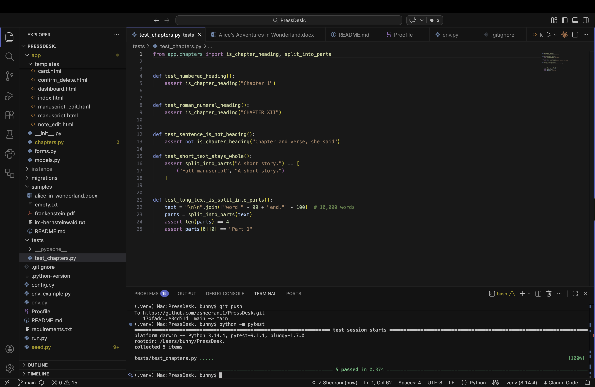


### Validators

| HTML | [W3C Markup Validator](https://validator.w3.org/)
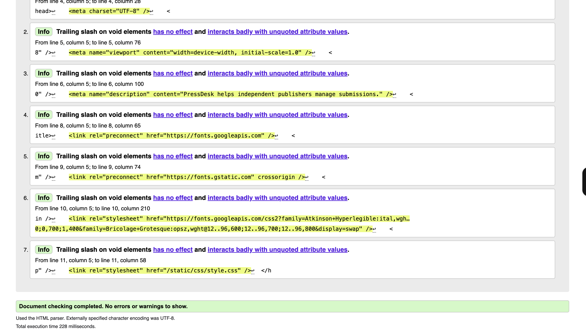

| CSS | [W3C CSS Validator (Jigsaw)](https://jigsaw.w3.org/css-validator/) 
.png)

| JavaScript | [JSHint](https://jshint.com/)
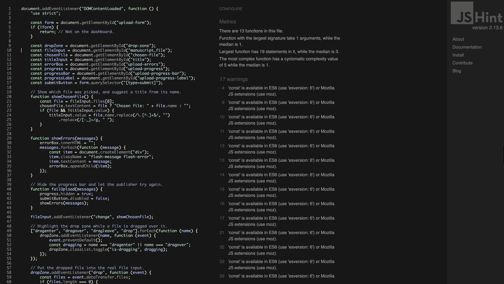

| Python | flake8 (PEP8) 
.png)

### Lighthouse

[Lighthouse](https://developer.chrome.com/docs/lighthouse) (Chrome DevTools)

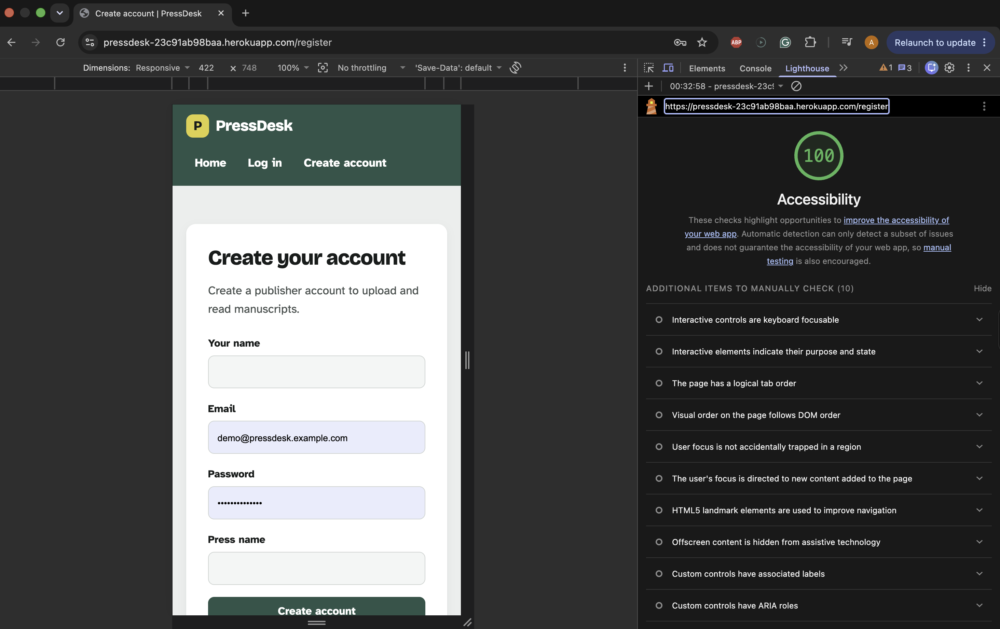


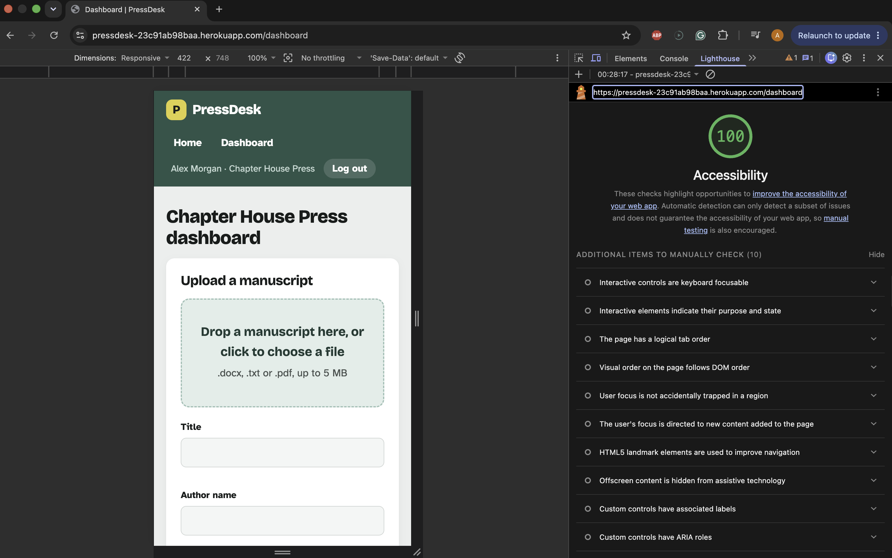


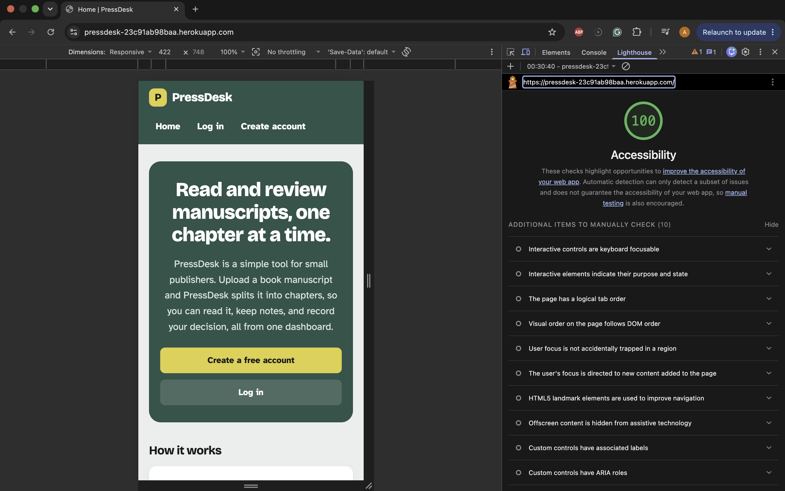

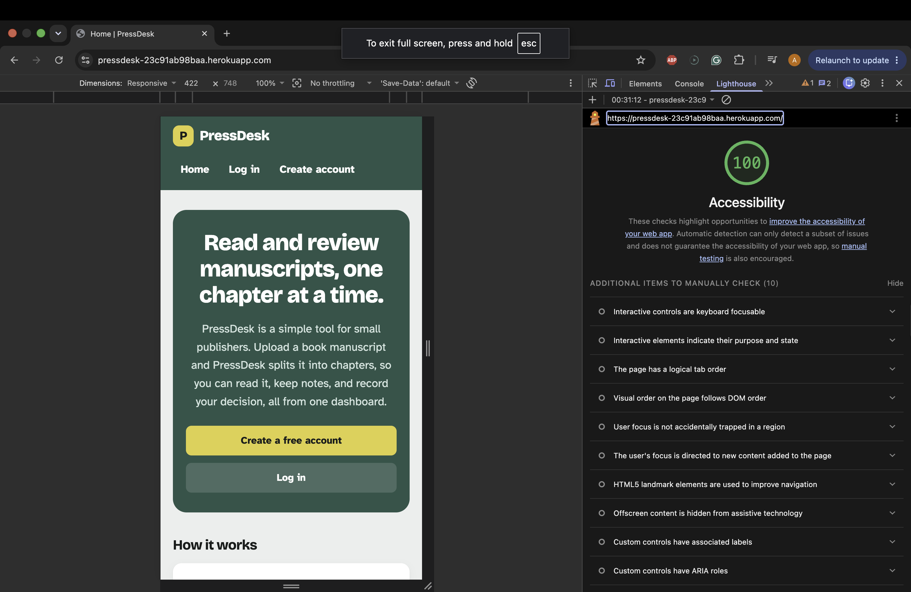

### Bugs

### Fixed bugs

**App features**

| Bug | Cause | Fix |
|---|---|---|
| Long manuscripts with no chapter headings appeared as one very long page. *Im Bernsteinwald* (about 27,500 words) loaded as a single "Full manuscript", which meant a huge amount of scrolling. | When no headings were found, all the text was kept as one chapter. | Added `split_into_parts()` in `app/chapters.py`. Long texts with no headings are now split into parts of about 3,000 words ("Part 1", "Part 2"…), breaking only at a blank line or the end of a sentence. Short texts still stay as one "Full manuscript". Two automated tests were added for this. |

**Sample files**

| Bug | Cause | Fix |
|---|---|---|
| The German sample couldn't be uploaded. | It was saved as `IM BERNSTEINWALD`, with capitals, a space and no file extension, so the app rejected it as an unsupported file type. | Renamed it to `im-bernsteinwald.txt`. |
| Project Gutenberg books created lots of near-empty chapters. | Each line of the contents list at the start of the book ("CHAPTER I.", "CHAPTER II."…) looks exactly like a chapter heading. | Removed the contents lists and the Gutenberg licence text from the sample files. Recorded as a known limitation below. |
| The Word sample didn't test Word heading styles. | The chapter titles in *Alice in Wonderland* were plain text, and the "CHAPTER I." lines were still there, so the app found the chapters through the "Chapter" check instead. | Deleted the "CHAPTER I." lines and styled each chapter name (e.g. "Down the Rabbit-Hole") as Heading 1, so the file now proves Heading 1 detection works on its own. |

**Demo data (`seed.py`)**

| Bug | Cause | Fix |
|---|---|---|
| `seed.py` stopped with "SyntaxError: invalid syntax. Perhaps you forgot a comma?" | Brackets and commas had been lost and duplicated while replacing the demo manuscripts with public-domain extracts. | Rebuilt the `MANUSCRIPTS` list and removed leftover closing brackets from the old version. |
| Running the seed did nothing, and the demo login failed on the live site. | The `main()` function and the `if __name__ == "__main__":` lines had been deleted while editing, so the script exited without running. | Restored them. The seed now prints what it creates. |
| The seed crashed with "ValueError: too many values to unpack (expected 4, got 6)". | Commas between the pieces of each chapter's text split one paragraph into several separate items. Python joins strings that sit next to each other, so the pieces shouldn't have commas between them. | Removed the commas so each paragraph is a single string. The seed then created the demo account and all three manuscripts. |

**Deployment**

| Bug | Cause | Fix |
|---|---|---|
| Heroku deploy failed at the release phase: "No module named 'psycopg'". | The app needed the psycopg 3 PostgreSQL driver, but only `psycopg2-binary` was in `requirements.txt`. | Installed `psycopg[binary]` and updated `requirements.txt`. |
| Heroku deploy failed again: "Can't find Python file migrations/env.py". | The `.gitignore` rule `env.py`, meant to keep the secret settings file private, also matched `migrations/env.py`, so it was never uploaded. | Changed the rule to `/env.py` so it only ignores the file at the top of the project, then committed `migrations/env.py`. |

**Code quality**

| Bug | Cause | Fix |
|---|---|---|
| flake8 reported PEP8 problems in `app/__init__.py`, `app/chapters.py`, `config.py`, `env_example.py` and `tests/test_chapters.py`. | Lines over 79 characters, wrong numbers of blank lines, indented comments, trailing spaces and missing final newlines. | Fixed with `autopep8` and by hand. flake8 now reports no errors. |
| JSHint showed 17 warnings for `const`. | JSHint checks against older JavaScript by default. | Added `/* jshint esversion: 6 */` to the top of `script.js`. |

**Documentation**

| Bug | Cause | Fix |
|---|---|---|
| Some README images didn't show. | Links pointed to an old `docs/screenshots/` folder, and file names with brackets, like `flake8-(pep8).png`, broke the Markdown links. | Updated all links to `assets/screenshots/` and renamed files to lowercase, hyphenated names with no spaces or brackets. |

### Known bugs and limitations

| Issue | Reason it's been left |
|---|---|
| A short line in the middle of a chapter that starts with "Chapter" and a number, e.g. "Chapter 3 had been the hardest to write.", would be treated as a heading. | Rare in real manuscripts. Checking the line length and the word after "Chapter" already catches most cases, such as "Chapter and verse". |
| *Frankenstein*'s four opening letters are kept together as one "Opening pages" section, not split. | Only "Chapter" headings are recognised. Recognising "Letter" headings is listed under Future features. |
| A contents list at the start of a book creates near-empty chapters. | Contents lines look the same as headings. Publishers are advised to remove the contents list before uploading; detecting it automatically is a future feature. |
| In files where each line is hard-wrapped, a part can end at a full stop in the middle of a paragraph rather than at the end of one. | Parts still never cut a sentence in half, which keeps them readable. |
| The last part of a long manuscript can be much shorter than the others. | It holds whatever text remains after the full-sized parts. |
| Manuscripts uploaded before parts were added aren't split. | Splitting happens on upload. Deleting and re-uploading the manuscript splits it. |
| Success messages disappear after 4 seconds, which may be too quick for some readers. | Error messages stay on screen. Making all messages dismissible by hand would be a future improvement. |
| Scanned PDFs can't be read. | They contain pictures of pages, not text. The app explains this and asks for a .docx or .txt version instead. |

### Known bugs

Bug	Why it's left
A short line starting "Chapter 3 had been…" in the middle of a chapter would be treated as a heading	[your explanation]
Contents lists at the start of a book create near-empty chapters	[your explanation]

## Deployment
## Deployment

PressDesk is deployed on [Heroku](https://www.heroku.com/) with a Heroku
Postgres database.

**Live site:** https://pressdesk-23c91ab98baa.herokuapp.com/

### Files Heroku needs

| File | Purpose |
|---|---|
| `requirements.txt` | Python packages to install, including `gunicorn` (web server) and `psycopg` (PostgreSQL driver). Created with `pip freeze > requirements.txt`. |
| `.python-version` | The Python version Heroku should use (`3.14`). |
| `Procfile` | Tells Heroku how to start the app and what to run before each release (see below). |

The `Procfile` contains:
web: gunicorn run:app
release: flask --app run db upgrade


- `web` starts the app with Gunicorn, using the `app` object in `run.py`.
- `release` runs the database migrations before each new version goes live,
  so the database tables always match the models.

### Environment variables

Secret values are never committed. Locally they are kept in `env.py`, which is
listed in `.gitignore`; `env_example.py` shows which settings are needed. On
Heroku they are set as Config Vars:

| Key | Value |
|---|---|
| `SECRET_KEY` | A long random string, different from the one used locally |
| `DATABASE_URL` | Added automatically by Heroku Postgres |
| `DEBUG` | `False` |

`config.py` reads these values and converts Heroku's `postgres://` database
address to the `postgresql://` form that SQLAlchemy expects.

### Steps

1. Prepare the project and push it to GitHub:
```bash
   pip freeze > requirements.txt
   echo "3.14" > .python-version
   git add requirements.txt .python-version Procfile
   git commit -m "Prepare app for Heroku deployment"
   git push
```
2. On the [Heroku dashboard](https://dashboard.heroku.com/), click
   **New → Create new app**, enter a name and choose the **Europe** region.
3. On the **Resources** tab, add the **Heroku Postgres** add-on
   (Essential-0 plan). This creates the database and sets `DATABASE_URL`.
4. On the **Settings** tab, click **Reveal Config Vars** A new secret key can be generated with:
```bash
   python -c "import secrets; print(secrets.token_hex(32))"
```
5. On the **Deploy** tab, choose **GitHub** as the deployment method, search
   for the `PressDesk` repository and click **Connect**.
6. Under **Manual deploy**, choose the `main` branch and click
   **Deploy Branch**. Heroku installs the packages, runs the release command
   (database migrations) and starts the app.
7. Click **Open app** to view the live site.

### Adding the demo data

The demo account and manuscripts are added with the seed script, using the
[Heroku CLI](https://devcenter.heroku.com/articles/heroku-cli):

```bash
brew install heroku/brew/heroku
heroku login
heroku run python seed.py -a pressdesk
```

The script prints each account and manuscript it creates. It is safe to run
more than once, because anything that already exists is skipped.

### Demo account

The live site includes a demo publisher account with sample manuscripts. It
holds sample data only.

- **Email:** demo@pressdesk.example.com
- **Password:** DemoPress2026!

### Checking the deployed version

After each deploy:

- The Heroku build and release steps showed green ticks, and the **Activity**
  tab showed "Deployed".
- The live site was tested in a private browser window using the full
  [manual testing](#manual-testing) table: registering, logging in, uploading
  each sample file, notes, statuses, deleting and the error pages.
- The results matched the local development version, including the same
  chapter counts for each sample file.
- Problems found during deployment are listed under [Fixed bugs](#fixed-bugs).

### Forking or cloning

To make your own copy of the project:

- **Fork:** on the GitHub repository page, click **Fork** to create a copy in
  your own account.
- **Clone:** click **Code**, copy the HTTPS address, and run:
```bash
  git clone https://github.com/zsheerani1/PressDesk.git
```
  Then follow [Running locally](#running-locally).

### Heroku
Create a new app on Heroku.
Add the Heroku Postgres add-on.
In Settings → Config Vars, add:
SECRET_KEY: a new random value
DEBUG: False
(DATABASE_URL is added automatically by Postgres.)
In Deploy, connect the GitHub repository and deploy the main branch.
Run the database migrations: [how you did it, e.g. the release line in the Procfile]
Optionally add demo data: heroku run python seed.py
[Check the live site matches the local version.]

### Demo account


The demo account contains sample data only:

Email: demo@pressdesk.example.com
Password: DemoPress2026!

## Running locally
bash
git clone https://github.com/zsheerani1/PressDesk.git
cd PressDesk
python3 -m venv .venv
source .venv/bin/activate
pip install -r requirements.txt
Copy env_example.py to a new file called env.py and fill in your own values.
Set up the database: flask --app run db upgrade
Optionally add demo data: python seed.py
Start the app: python run.py

## Development notes
The app is built with Flask and was developed in VS Code.

### Version control

The project was developed locally for several weeks before version control was set up. It was moved into this repository on 22 October 2026, so the first commit contains the application as it stood at that point. Every change since then, including new features, bug fixes, testing, deployment and documentation, has been committed separately with a message describing it.

### Changes made during testing and deployment

Testing the deployed app with real books led to several improvements:

- Public-domain books from Project Gutenberg replaced the original sample files, which exposed issues with contents lists and Word heading styles.
- Testing a long German text with no chapter headings led to a new feature: splitting long manuscripts into parts of about 3,000 words.
- Deploying to Heroku uncovered a missing PostgreSQL driver and a `.gitignore` rule that hid a migration file.
- The code was checked with flake8, JSHint, the W3C validators and Lighthouse, and the problems found were fixed.

## Credits
### Code

## Credits

### Code

- **Application factory:** the `create_app()` function in `app/__init__.py`
  follows the
  [Application Factories](https://flask.palletsprojects.com/en/stable/patterns/appfactories/)
  pattern from the Flask documentation.
- **User accounts:** login and logout use [Flask-Login](https://flask-login.readthedocs.io/), following its
  documentation.
- **Forms and CSRF protection:** [Flask-WTF](https://flask-wtf.readthedocs.io/) and its [CSRF protection](https://flask-wtf.readthedocs.io/en/stable/csrf/)
  guide.
- **Database:** [Flask-SQLAlchemy](https://flask-sqlalchemy.readthedocs.io/) or the models and
  [Flask-Migrate](https://flask-migrate.readthedocs.io/) for migrations.
- **Reading files:** [python-docx](https://python-docx.readthedocs.io/) for Word documents and [pypdf](https://pypdf.readthedocs.io/) for PDFs.
- - **Procfile:** the `web` and `release` process types follow Heroku's
  [Procfile](https://devcenter.heroku.com/articles/procfile) and
  [Release Phase](https://devcenter.heroku.com/articles/release-phase)
  documentation.

**Deployment:** Heroku's
  [Getting Started with Python](https://devcenter.heroku.com/articles/getting-started-with-python) guide and [Heroku CLI](https://devcenter.heroku.com/articles/heroku-cli)
  documentation.
  
**Other tools**
- Claude was used for the generation of the README template and for the generation of the wireframes.
The entity relationship diagram was created with [dbdiagram.io](https://dbdiagram.io) from the models in `app/models.py`.

### Content

- Sample manuscripts:

### Content
- Frankenstein by Mary Shelley, Alice's Adventures in Wonderland by Lewis Carroll and Im Bernsteinwald by Wilhelm Bölsche: public domain, from Project Gutenberg, downloaded for samples.
- Demo manuscripts in seed.py use short extracts from public-domain novels by Jane Austen, Charles Dickens and Herman Melville.

### Fonts
Bricolage Grotesque and Atkinson Hyperlegible from Google Fonts.
